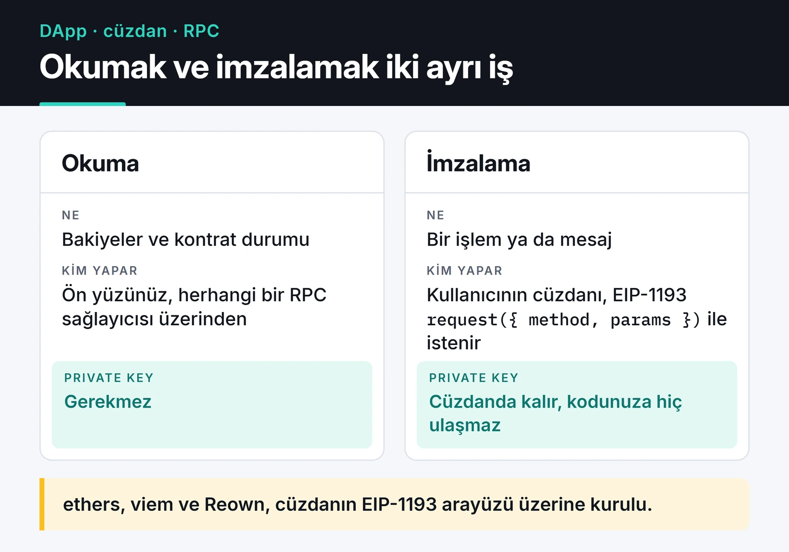
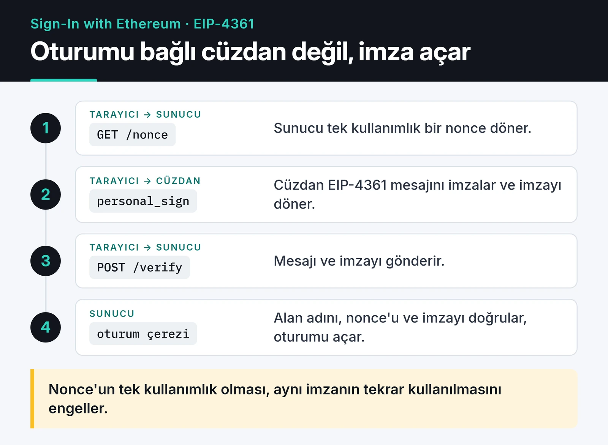

Web3 cüzdan entegrasyonu bir DApp'in kullanıcıyla ilk temas noktası. Web3 projeleriyle uğraşırken yazdığım bağlantı kodunun çoğu `window.ethereum` üzerine kuruluydu. Bu yaklaşım hâlâ çalışıyor ama artık doğru başlangıç noktası değil. Tarayıcıda birden fazla cüzdan eklentisi varken hangisinin `window.ethereum` nesnesini ele geçireceği belli olmuyor. WalletConnect de Reown adını aldı ve API'si değişti.

Bu yazıda sıfırdan bir cüzdan bağlantısı kursam nasıl yapacağımı anlatıyorum: EIP-6963 ile cüzdan keşfi, ethers v6 ile bağlantı, ağ yönetimi, mobil cüzdanlar için Reown AppKit ve imzayla giriş (Sign-In with Ethereum).

## Parçalar nasıl birbirine bağlanıyor

Okumak ve imzalamak iki ayrı iş. Aşağıdaki kart bu ayrımı gösteriyor.



Ön yüz bakiye, kontrat durumu gibi verileri bir RPC sağlayıcısından okuyabilir. Bir işlemi ya da mesajı imzalamak ise sadece kullanıcının cüzdanında olur; özel anahtar hiçbir zaman sizin kodunuza gelmez. Cüzdanlar tarayıcıya EIP-1193 standardına uyan bir `request({ method, params })` arayüzü sunar. ethers, viem ve Reown gibi kütüphanelerin hepsi bu arayüzün üstüne kuruludur.

## EIP-6963: window.ethereum yerine cüzdan keşfi

Eski yöntemde her cüzdan eklentisi `window.ethereum` nesnesini yazmaya çalışıyordu. İki cüzdan yüklü bir kullanıcıda hangisinin kazanacağı eklentilerin yüklenme sırasına bağlıydı. EIP-6963 bunu olay tabanlı bir keşifle çözüyor: sayfa "kim var?" diye soruyor, her cüzdan kendini adı, ikonu ve sağlayıcısıyla tanıtıyor.

```javascript {title="wallets.js"}
import { BrowserProvider, getAddress } from "ethers";

const wallets = new Map();

window.addEventListener("eip6963:announceProvider", (event) => {
  const { info, provider } = event.detail; // info: { uuid, name, icon, rdns }
  wallets.set(info.uuid, { info, provider });
  renderWalletButtons([...wallets.values()]);
});

// Yüklü cüzdanlardan kendilerini tanıtmalarını iste
window.dispatchEvent(new Event("eip6963:requestProvider"));

export async function connect(uuid) {
  const { provider: eip1193 } = wallets.get(uuid);
  const accounts = await eip1193.request({ method: "eth_requestAccounts" });

  const provider = new BrowserProvider(eip1193);
  const signer = await provider.getSigner();
  const { chainId } = await provider.getNetwork(); // bigint

  return { eip1193, provider, signer, address: getAddress(accounts[0]), chainId };
}

function renderWalletButtons(list) {
  const container = document.querySelector("#wallets");
  container.replaceChildren(
    ...list.map(({ info }) => {
      const button = document.createElement("button");
      button.textContent = info.name;
      button.onclick = () => connect(info.uuid);
      return button;
    }),
  );
}
```

Kullanıcı hangi cüzdanı kullanacağını kendisi seçiyor ve siz de seçilen cüzdanın sağlayıcısıyla çalışıyorsunuz. `info.rdns` (örneğin `io.metamask`) son kullanılan cüzdanı hatırlamak için kullanışlı bir anahtar.

ethers v6'yı eski örneklerden ayıran birkaç nokta: `providers.Web3Provider` yerine `BrowserProvider` var, `getSigner()` artık async, miktarlar ve `chainId` `BigNumber` değil yerel `bigint`. `ethers.utils.parseEther` de doğrudan `ethers.parseEther` oldu.

## Hesap ve ağ değişiklikleri

Kullanıcı bağlıyken cüzdanında hesap ya da ağ değiştirebilir. Eski kodumda her değişiklikte sayfayı yeniliyordum. ethers v6'da `BrowserProvider` bağlandığı ağı önbelleğe aldığı için, ağ değiştiğinde en temiz yol sağlayıcıyı yeniden oluşturmak:

```javascript
export function watch(session, onChange) {
  const { eip1193 } = session;

  eip1193.on("accountsChanged", (accounts) => {
    if (accounts.length === 0) return onChange(null); // kullanıcı bağlantıyı kesti
    onChange({ ...session, address: getAddress(accounts[0]) });
  });

  eip1193.on("chainChanged", async () => {
    const provider = new BrowserProvider(eip1193); // eski provider'ı kullanmayın
    const signer = await provider.getSigner();
    const { chainId } = await provider.getNetwork();
    onChange({ ...session, provider, signer, chainId });
  });
}
```

Kullanıcı yanlış ağdaysa, ağ değiştirmeyi kendiniz isteyebilirsiniz. Cüzdan o ağı tanımıyorsa 4902 hatası döner; bu durumda ağı eklemeyi önermek gerekiyor:

```javascript
const BASE_SEPOLIA = {
  chainId: "0x14a34", // 84532
  chainName: "Base Sepolia",
  nativeCurrency: { name: "Ether", symbol: "ETH", decimals: 18 },
  rpcUrls: ["https://sepolia.base.org"],
  blockExplorerUrls: ["https://sepolia.basescan.org"],
};

export async function ensureChain(eip1193, chain = BASE_SEPOLIA) {
  try {
    await eip1193.request({
      method: "wallet_switchEthereumChain",
      params: [{ chainId: chain.chainId }],
    });
  } catch (err) {
    if (err.code !== 4902) throw err; // 4001: kullanıcı reddetti
    await eip1193.request({ method: "wallet_addEthereumChain", params: [chain] });
  }
}
```

Hata kodlarını kullanıcıya anlaşılır mesajlara çevirmek arayüzün kalitesini çok değiştiriyor. En sık karşılaştıklarım: `4001` kullanıcının isteği reddetmesi (hata değil, normal bir seçim), `-32002` cüzdanda zaten bekleyen bir istek olması (kullanıcı açık pencereyi kapatmadan ikinci kez tıklamış), `4902` bilinmeyen ağ.

## Mobil cüzdanlar: Reown AppKit

EIP-6963 sadece tarayıcı eklentilerini bulur. Telefonundaki cüzdanla bağlanmak isteyen kullanıcı için WalletConnect protokolü gerekiyor. WalletConnect'in arkasındaki şirket 2024'te adını Reown olarak değiştirdi ve eski Web3Modal artık Reown AppKit adıyla geliyor. Hazır bir modal; QR kodla mobil bağlantı, tarayıcı eklentileri (EIP-6963 dahil) ve ağ seçimi tek pakette.

```bash
npm install @reown/appkit @reown/appkit-adapter-ethers ethers
```

```javascript {title="appkit.js"}
import { createAppKit } from "@reown/appkit";
import { EthersAdapter } from "@reown/appkit-adapter-ethers";
import { base, baseSepolia } from "@reown/appkit/networks";
import { BrowserProvider } from "ethers";

const modal = createAppKit({
  adapters: [new EthersAdapter()],
  networks: [base, baseSepolia],
  projectId: import.meta.env.VITE_REOWN_PROJECT_ID, // dashboard.reown.com
  metadata: {
    name: "Örnek DApp",
    description: "Cüzdan entegrasyonu örneği",
    url: "https://app.example.com", // gerçek alan adınızla birebir aynı olmalı
    icons: ["https://app.example.com/icon.png"],
  },
});

let walletProvider = null;
modal.subscribeProviders((state) => {
  walletProvider = state["eip155"];
});

document.querySelector("#connect").addEventListener("click", () => modal.open());

export async function signHello() {
  if (!walletProvider) throw new Error("Önce cüzdan bağlayın");
  const signer = await new BrowserProvider(walletProvider).getSigner();
  return signer.signMessage("Merhaba");
}
```

Proje ID'sini Reown Dashboard'dan ücretsiz alıyorsunuz. `metadata.url` alanı, cüzdanların alan adı doğrulamasında kullanılıyor; yanlış yazarsanız kullanıcı cüzdanında uyarı görür. React projelerinde aynı işi wagmi adaptörüyle ve hook'larla yapmak daha rahat, ama alttaki mantık aynı.

Kararım genelde şöyle: sadece masaüstü ve eklenti kullanıcıları hedefleniyorsa EIP-6963 ile kendi küçük listemi yazıyorum. Mobil cüzdan desteği gerekiyorsa tekerleği yeniden icat etmeyip AppKit kullanıyorum.

## İmzayla giriş: Sign-In with Ethereum

Cüzdan bağlamak, kullanıcının o adresin sahibi olduğunu kanıtlamaz; ön yüz herhangi bir adresi gösterebilir. Sunucu tarafında oturum açmak için kullanıcının bir mesajı imzalaması ve sunucunun bu imzayı doğrulaması gerekiyor. EIP-4361 (Sign-In with Ethereum) bu mesajın standart biçimini tanımlıyor.

Akış dört adımdan oluşuyor: tarayıcı sunucudan bir nonce alıyor, cüzdana mesajı imzalatıyor, mesajla imzayı sunucuya gönderiyor ve sunucu doğrulayınca oturum açıyor.



Mesajı oluşturan ve sunucuda doğrulayan minimal bir örnek:

```javascript {title="siwe.js"}
import { getAddress, hexlify, randomBytes, verifyMessage } from "ethers";

export function buildSiweMessage({ domain, uri, address, chainId, nonce, statement }) {
  return [
    `${domain} wants you to sign in with your Ethereum account:`,
    address,
    "",
    statement,
    "",
    `URI: ${uri}`,
    "Version: 1",
    `Chain ID: ${chainId}`,
    `Nonce: ${nonce}`,
    `Issued At: ${new Date().toISOString()}`,
  ].join("\n");
}

// Sunucu tarafı
const nonces = new Set(); // gerçek uygulamada Redis gibi süreli bir depo

export function issueNonce() {
  const nonce = hexlify(randomBytes(16)).slice(2);
  nonces.add(nonce);
  return nonce;
}

export function verifySiwe({ message, signature }, expectedDomain) {
  const lines = message.split("\n");
  const domain = lines[0].replace(" wants you to sign in with your Ethereum account:", "");
  const claimed = getAddress(lines[1]);
  const nonce = lines.find((l) => l.startsWith("Nonce: "))?.slice(7);

  if (domain !== expectedDomain) throw new Error("wrong domain");
  if (!nonce || !nonces.delete(nonce)) throw new Error("unknown or reused nonce");
  if (verifyMessage(message, signature) !== claimed) throw new Error("bad signature");
  return claimed;
}
```

Bu kodda üç kontrol var ve üçü de gerekli. Alan adı kontrolü, başka bir sitede imzalatılan mesajın sizin sitenizde kullanılmasını engelliyor. Tek kullanımlık nonce, aynı imzanın tekrar gönderilmesini (replay) engelliyor. İmza kontrolü de mesajı gerçekten o adresin imzaladığını kanıtlıyor.

Bir sınırlama var: `verifyMessage` sadece normal (EOA) hesapların imzasını doğrular. Safe gibi akıllı kontrat cüzdanları ve hesap soyutlaması kullanan cüzdanlar imzayı ERC-1271 ile kontrat üzerinden doğrulatır. Bu kullanıcıları da desteklemek istiyorsanız viem'in `viem/siwe` modülündeki `parseSiweMessage` ve bir public client üzerinden `verifySiweMessage` kullanmak daha doğru; ikisi de bu durumları ele alıyor. Yukarıdaki kodu mantığı görmek için yazdım, üretimde standart kütüphanelerden birini tercih ederim.

Birden fazla alanı olan yapılandırılmış veriler (örneğin bir sipariş ya da izin) için düz metin yerine EIP-712 typed data imzası (`signer.signTypedData(domain, types, value)`) kullanın. Kullanıcı cüzdanında alanları tek tek görür, ne imzaladığını anlaması kolaylaşır.

## Güvenlik notları

- Kullanıcıdan asla gizli kelimeler (seed phrase) ya da özel anahtar istemeyin. Bunu isteyen her arayüz oltalama girişimidir.
- Ham hash imzalatan eski `eth_sign` metodunu kullanmayın; kullanıcı neyi imzaladığını göremez. `personal_sign` ve EIP-712 yeterli.
- İşlem göndermeden önce `chainId` değerini kontrol edin. Yanlış ağda gönderilen bir işlem en iyi ihtimalle başarısız olur.
- Token onaylarında (approve) sınırsız miktar istemek yerine gereken miktarı isteyin.
- İşlemi göndermeden önce `estimateGas` ya da `call` ile simüle edin; revert edecek bir işlem için kullanıcıya imza penceresi açmayın.
- Ön yüzün gösterdiği adrese değil, sunucuda doğrulanmış imzaya güvenin.

## Sırada ne var

EIP-6963 örneğini bir HTML sayfasına koyup iki farklı cüzdan eklentisiyle deneyin; ikisinin de listede ayrı ayrı göründüğünü görmek eski `window.ethereum` yaklaşımının sorununu en iyi anlatan şey. Ardından SIWE akışını küçük bir Express sunucusuna bağlayın.

Kontrat tarafının nasıl test edildiğini [Hardhat 3 ile akıllı kontrat testi](/posts/smart-contract-testing-hardhat-ethers/) yazımda, sık görülen açıkları [Ethereum akıllı kontrat güvenliği](/posts/ethereum-smart-contract-security-best-practices/) yazımda, Python tarafından zincirle konuşmayı da [web3.py ile Ethereum etkileşimi](/posts/web3py-ethereum-blockchain-etkilesimi/) yazımda anlattım. Standartların kendisi için [EIP-6963](https://eips.ethereum.org/EIPS/eip-6963), [EIP-4361](https://eips.ethereum.org/EIPS/eip-4361) ve [Reown AppKit belgeleri](https://docs.reown.com/appkit/javascript/core/installation) en doğru kaynaklar.
