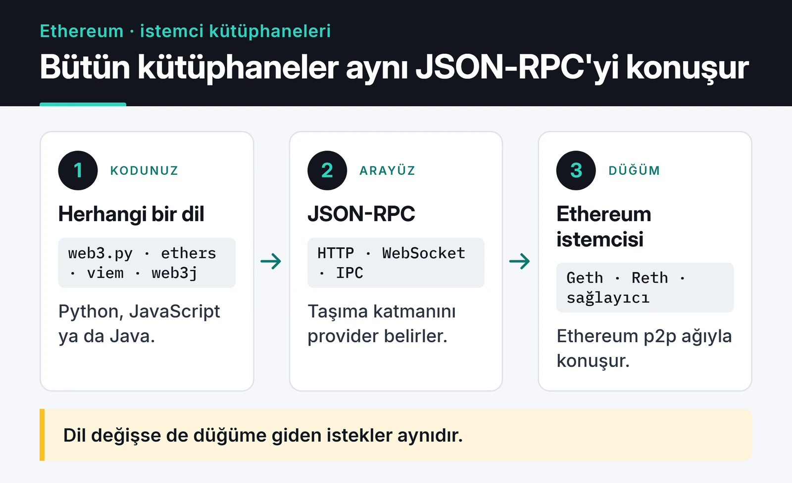

Ethereum araçlarının çoğu JavaScript dünyasından çıkıyor ama ben zincirle konuşan kodun büyük kısmını Python'da yazdım: trading botları, veri toplayan script'ler, Telegram bildirimleri. Bunların hepsinin altında web3.py vardı. Bu yazıda web3.py ile Ethereum etkileşiminde kullandığım kalıpları topluyorum.

v7 ile birkaç önemli şey değişti: `geth_poa_middleware` artık yok, WebSocket provider baştan yazıldı, `rawTransaction` gibi camelCase alanlar snake_case oldu. Aşağıdaki kodları web3.py 7.16 ile çalıştırdım. 8.0 ile de değişmeden çalıştılar, ama 8'e geçmeden önce resmi sürüm notlarını okumanızı öneririm. web3.py 8, Python 3.10 ve üstünü istiyor.

```bash
pip install "web3>=7,<9" python-dotenv
```

## Provider seçimi

web3.py düğümle JSON-RPC üzerinden konuşur. Hangi taşıma katmanını kullanacağınızı provider belirler. Şemada görüldüğü gibi ethers, viem ya da web3j de aynı arayüzü kullanıyor; dil değişse de düğüme giden istekler aynı.



`HTTPProvider` script'ler ve istek-cevap tarzı işler için yeterli. Bakiye okumak, bir kontrat fonksiyonunu çağırmak, işlem göndermek gibi:

```python {title="connect.py"}
from web3 import Web3

w3 = Web3(Web3.HTTPProvider(
    "https://ethereum-rpc.publicnode.com",
    request_kwargs={"timeout": 15},
))

print(w3.is_connected(), w3.eth.chain_id, w3.eth.block_number)

vitalik = "0xd8dA6BF26964aF9D7eEd9e03E53415D37aA96045"
print(w3.from_wei(w3.eth.get_balance(vitalik), "ether"))
```

Halka açık bir RPC'ye karşı çalıştırdığımda ilk satır bağlantıyı, zincir kimliğini (ana ağ için 1) ve son blok numarasını, ikinci satır ETH bakiyesini yazdırdı:


Halka açık RPC adresleri deneme için iyi ama hız limitleri düşük ve garantisi yok. Uzun süre çalışan bir bot için Alchemy, Infura, QuickNode gibi bir sağlayıcıdan anahtar almak ya da kendi düğümünüzü çalıştırmak gerekiyor. Aynı makinede bir Geth veya Reth düğümü varsa `IPCProvider` en düşük gecikmeyi verir. Bir Python botu ile tarayıcıdaki bir dApp arasındaki fark, imzanın nerede atıldığı: bot kendi yerel anahtarıyla imzalar, dApp'te ise anahtar tarayıcı cüzdanında kalır.

## Async: AsyncHTTPProvider

Botlarımın çoğu aynı anda onlarca adresin veya havuzun durumunu okuyor. Senkron kodda bu istekler sırayla gider. `AsyncWeb3` ile hepsini aynı anda gönderip `asyncio.gather` ile toplayabilirsiniz:

```python {title="async_balances.py"}
import asyncio
from web3 import AsyncWeb3

RPC = "https://ethereum-rpc.publicnode.com"

async def main(addresses: list[str]) -> None:
    w3 = AsyncWeb3(AsyncWeb3.AsyncHTTPProvider(RPC))
    balances = await asyncio.gather(*(w3.eth.get_balance(a) for a in addresses))
    for address, wei in zip(addresses, balances):
        print(address, w3.from_wei(wei, "ether"))

asyncio.run(main([
    "0xd8dA6BF26964aF9D7eEd9e03E53415D37aA96045",
    "0xA0b86991c6218b36c1d19D4a2e9Eb0cE3606eB48",
]))
```

Burada kazanç tamamen ağ beklemesinden geliyor. RPC sağlayıcınızın saniye başına istek limitini aşmamak için çok sayıda istek gönderiyorsanız bir `asyncio.Semaphore` ile eşzamanlılığı sınırlayın. asyncio tarafını [asyncio ile paralel işlem yazımda](/posts/python-asyncio-paralel-islem/) daha ayrıntılı anlattım.

## WebSocket ile yeni blokları dinlemek

v7 ile gelen `WebSocketProvider` sadece async çalışıyor ve aboneliklerle (subscription) birlikte kullanılmak üzere tasarlandı. Yeni blok başlıklarını şöyle dinliyorum:

```python {title="new_heads.py"}
import asyncio
from web3 import AsyncWeb3, WebSocketProvider

async def main() -> None:
    async with AsyncWeb3(WebSocketProvider("wss://ethereum-rpc.publicnode.com")) as w3:
        subscription_id = await w3.eth.subscribe("newHeads")
        async for message in w3.socket.process_subscriptions():
            header = message["result"]
            print("yeni blok:", header["number"])

asyncio.run(main())
```

`async with` bloğu bağlantıyı açıp kapatıyor. WebSocket bağlantıları uzun süre açık kaldığında kopabiliyor. web3.py bunun için `async for w3 in AsyncWeb3(WebSocketProvider(url)):` şeklinde, bağlantı her koptuğunda yeniden bağlanan bir kalıp sunuyor. Ama kopma sırasında kaçan blokları sizin için doldurmuyor. Bu yüzden canlı bir botta son işlediğim blok numarasını saklıyorum ve bağlantı geri geldiğinde aradaki blokları HTTP ile okuyorum.

## Hesap ve private key yönetimi

Private key'i koda yazmak en sık yapılan hata. En azından ortam değişkeninden okuyun, sunucuda bir secret manager kullanın ve bot için sadece işine yetecek kadar bakiye tutan ayrı bir cüzdan açın:

```python
import os
from dotenv import load_dotenv
from eth_account import Account

load_dotenv()
account = Account.from_key(os.environ["PRIVATE_KEY"])
print(account.address)
```

`.env` dosyasının `.gitignore` içinde olduğundan emin olun. GitHub'a yanlışlıkla gönderilen anahtarları tarayan botlar gerçekten var ve fonları dakikalar içinde boşaltıyorlar.

## EIP-1559 işlemi kurmak ve göndermek

London güncellemesinden beri işlemlerde `gasPrice` yerine iki alan var: `maxPriorityFeePerGas` (doğrulayıcıya bahşiş) ve `maxFeePerGas` (ödemeye razı olduğunuz üst sınır). Ödenen ücret base fee artı bahşiş oluyor, üst sınırın kullanılmayan kısmı size kalıyor.

```python {title="send_eth.py"}
from web3 import Web3

def build_transfer(w3: Web3, account, to: str, amount_eth: float) -> dict:
    latest = w3.eth.get_block("latest")
    priority = w3.eth.max_priority_fee
    tx = {
        "type": 2,
        "chainId": w3.eth.chain_id,
        "nonce": w3.eth.get_transaction_count(account.address, "pending"),
        "to": Web3.to_checksum_address(to),
        "value": w3.to_wei(amount_eth, "ether"),
        "maxPriorityFeePerGas": priority,
        "maxFeePerGas": 2 * latest["baseFeePerGas"] + priority,
    }
    tx["gas"] = w3.eth.estimate_gas({**tx, "from": account.address})
    return tx


w3 = Web3(Web3.HTTPProvider("https://ethereum-sepolia-rpc.publicnode.com"))
tx = build_transfer(w3, account, "0xAlıcıAdresi...", 0.001)
signed = account.sign_transaction(tx)
tx_hash = w3.eth.send_raw_transaction(signed.raw_transaction)
receipt = w3.eth.wait_for_transaction_receipt(tx_hash, timeout=180)
print("durum:", receipt["status"], "blok:", receipt["blockNumber"])
```

Birkaç not:

- `maxFeePerGas` için `2 * baseFee + priority` yaygın bir formül. Base fee art arda birkaç dolu blokta yükselse bile işlemin takılmamasını sağlıyor.
- Gas miktarını elle `21000` yazmak yerine `estimate_gas` ile soruyorum. Alıcı bir kontratsa düz transfer bile daha fazla gas harcayabilir.
- Nonce'u `"pending"` ile alıyorum, böylece mempool'daki kendi bekleyen işlemlerimi de sayıyor. Aynı cüzdandan paralel işlem gönderen bir bot nonce'u kendisi takip etmeli. Aksi halde "nonce too low" ya da "replacement transaction underpriced" hataları geliyor.
- v7'de imzalı işlemin alanı `signed.raw_transaction`. Eski `signed.rawTransaction` artık yok.
- `receipt["status"] == 0` işlemin bloğa girdiğini ama revert ettiğini gösterir. Gas yine de ödenmiştir.

Her işlemi elle imzalamak istemiyorsanız `SignAndSendRawMiddlewareBuilder.build(account)` middleware'ini ekleyip `w3.eth.send_transaction({...})` kullanabilirsiniz. Ben açık olduğu için yukarıdaki yolu tercih ediyorum.

Bu kodu önce Sepolia'da deneyin. Test ETH'yi bir faucet'ten alabilirsiniz. Ana ağda yanlış adrese gönderilen işlem geri alınmıyor.

## Kontrat okumak: ERC-20 örneği

Bir kontratla konuşmak için adres ve ABI gerekiyor. ABI'nin tamamına ihtiyacınız yok, kullanacağınız fonksiyon ve event'ler yeterli:

```python {title="erc20.py"}
from web3 import Web3

ERC20_ABI = [
    {"name": "balanceOf", "type": "function", "stateMutability": "view",
     "inputs": [{"name": "owner", "type": "address"}],
     "outputs": [{"name": "", "type": "uint256"}]},
    {"name": "decimals", "type": "function", "stateMutability": "view",
     "inputs": [], "outputs": [{"name": "", "type": "uint8"}]},
    {"name": "symbol", "type": "function", "stateMutability": "view",
     "inputs": [], "outputs": [{"name": "", "type": "string"}]},
    {"name": "Transfer", "type": "event", "anonymous": False, "inputs": [
        {"name": "from", "type": "address", "indexed": True},
        {"name": "to", "type": "address", "indexed": True},
        {"name": "value", "type": "uint256", "indexed": False}]},
]

w3 = Web3(Web3.HTTPProvider("https://ethereum-rpc.publicnode.com"))
USDC = Web3.to_checksum_address("0xa0b86991c6218b36c1d19d4a2e9eb0ce3606eb48")
usdc = w3.eth.contract(address=USDC, abi=ERC20_ABI)

decimals = usdc.functions.decimals().call()
raw = usdc.functions.balanceOf("0xd8dA6BF26964aF9D7eEd9e03E53415D37aA96045").call()
print(usdc.functions.symbol().call(), raw / 10**decimals)
```

Adresleri `to_checksum_address` ile normalize ediyorum. web3.py, checksum'ı yanlış bir adres verdiğinizde hata fırlatıyor ve bu bir kopyala-yapıştır hatasını yakalamanın en ucuz yolu. Ondalıkları da her zaman kontrattan okuyun: USDC 6, çoğu ERC-20 18 ondalıklı.

`.call()` zincirde değişiklik yapmaz ve ücretsizdir. Durum değiştiren fonksiyonlar için `.build_transaction({...})` ile yukarıdaki gibi bir işlem kurup imzalarsınız.

## Event'leri parça parça okumak

Geçmiş transferleri okumak için event logları en verimli yol. v7'de blok aralığı argümanları snake_case oldu: `from_block`, `to_block`.

```python
def get_logs_chunked(event, start: int, end: int, step: int = 2_000):
    for frm in range(start, end + 1, step):
        to = min(frm + step - 1, end)
        yield from event.get_logs(from_block=frm, to_block=to)


latest = w3.eth.block_number
for log in get_logs_chunked(usdc.events.Transfer, latest - 10, latest):
    print(log["args"]["from"], log["args"]["to"], log["args"]["value"])
```

Tek seferde çok geniş bir aralık istemek RPC sağlayıcısının limitine takılıyor. Sağlayıcıların çoğu blok aralığını ya da dönen log sayısını sınırlıyor. Parça boyutunu sağlayıcınıza göre ayarlayın ve hata aldığınızda aralığı küçültüp tekrar deneyin. Milyonlarca kayıt üzerinde analiz yapacaksanız logları bir veritabanına yazan küçük bir indexer kurmak daha mantıklı. Bunu [blockchain veri analizi yazısında](/posts/blockchain-veri-analizi-python-araclari/) anlattım.

## PoA ağları ve middleware

Polygon PoS, BNB Smart Chain gibi bazı ağlar blok başlığındaki `extraData` alanında 32 byte'tan fazla veri taşıyor. web3.py bu blokları okurken `ExtraDataLengthError` fırlatıyor. Polygon'un public RPC'siyle denediğimde tam olarak bu hatayı aldım. Çözüm middleware eklemek:

```python
from web3 import Web3
from web3.middleware import ExtraDataToPOAMiddleware

w3 = Web3(Web3.HTTPProvider("https://polygon-bor-rpc.publicnode.com"))
w3.middleware_onion.inject(ExtraDataToPOAMiddleware, layer=0)
print(w3.eth.chain_id, w3.eth.get_block("latest")["number"])
```

v6'daki `geth_poa_middleware` ismi v7'de `ExtraDataToPOAMiddleware` oldu. v7'de middleware'ler sınıf tabanlı. Kendi middleware'inizi yazmak isterseniz `Web3Middleware` sınıfından türetip `request_processor` ve `response_processor` metodlarını override ediyorsunuz.

## Hataları yakalamak

v7 ile hata sınıfları da düzenlendi. En sık karşılaştıklarım:

```python
from web3.exceptions import ContractLogicError, TimeExhausted, Web3RPCError

try:
    tx_hash = w3.eth.send_raw_transaction(signed.raw_transaction)
    receipt = w3.eth.wait_for_transaction_receipt(tx_hash, timeout=180)
except ContractLogicError as e:
    print("kontrat revert etti:", e)
except Web3RPCError as e:
    print("RPC hatası:", e)          # yetersiz bakiye, düşük nonce vb.
except TimeExhausted:
    print("işlem 3 dakikada bloğa girmedi")
```

`TimeExhausted` işlemin başarısız olduğu anlamına gelmiyor, sadece beklemeyi bıraktığınızı gösteriyor. İşlem mempool'da hâlâ bekliyor olabilir. Bu durumda aynı nonce ile daha yüksek ücretli bir işlem göndererek onu değiştirebilirsiniz.

## Test için yerel zincir

Ana ağa hiç dokunmadan denemek için [Anvil](https://getfoundry.sh/) ile ana ağın bir kopyasını yerelde açıyorum:

```bash
anvil --fork-url "$MAINNET_RPC_URL"
```

Sonra `Web3(Web3.HTTPProvider("http://127.0.0.1:8545"))` ile bağlanıyorum. Anvil, önceden ETH yüklenmiş test hesaplarıyla geliyor ve gerçek Uniswap ya da USDC kontratlarıyla para harcamadan konuşabiliyorsunuz.

## Sırada ne var

Buradaki parçaları bir araya getiren gerçek bir projeyi [flash loan arbitraj botu yazısında](/posts/building-flash-loan-arbitrage-bot/) inceledim. Okuduğunuz veriyi işlemek için [pandas ile kripto veri analizi](/posts/python-pandas-kripto-para-piyasa-analizi/) yazısına bakabilirsiniz. Resmi referans için [web3.py dokümantasyonu](https://web3py.readthedocs.io/) ve özellikle v6'dan v7'ye geçiş rehberi en güncel kaynak.
