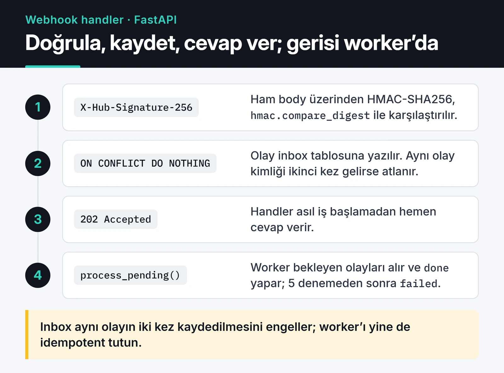

Ödeme sağlayıcısına dakikada bir "ödeme geldi mi?" diye sormak yerine, sağlayıcı olay olduğu anda size bir HTTP isteği atar. Webhook budur ve olay güdümlü mimarinin dış dünyaya açılan kapısıdır. Bir webhook handler yazmak ilk bakışta tek bir POST endpoint'i gibi görünüyor. Sonra şu sorular geliyor: Bu isteği gerçekten sağlayıcı mı gönderdi? Sunucum o sırada kapalıysa ne olacak? Aynı olay iki kez gelirse ne olacak?

Bu yazıda bu üç soruya cevap veren bir webhook handler'ı Python ve FastAPI ile adım adım kuruyorum. Örnek GitHub webhook'ları üzerinden, ama aynı desen Stripe, Shopify ya da başka herhangi bir sağlayıcı için geçerli.

## Genel akış

Handler'ın tek görevi isteği doğrulamak, kalıcı bir yere yazmak ve hemen cevap dönmek. Asıl iş ayrı bir worker'da yapılıyor:



## İmza doğrulama: ham gövde üzerinden HMAC

Webhook endpoint'i herkese açık olmak zorunda. İmza kontrolü yapmazsanız biri `curl` ile sahte bir "ödeme başarılı" olayı gönderebilir. Sağlayıcılar gövdeyi sizinle paylaştıkları bir gizli anahtarla HMAC-SHA256 ile imzalayıp sonucu bir header'a koyuyor. GitHub için bu `X-Hub-Signature-256: sha256=<hex>`.

İki ayrıntı önemli. Birincisi, imzayı ham gövde üzerinden hesaplayın. JSON'u parse edip tekrar serileştirirseniz boşluklar ve anahtar sırası değişir, imza tutmaz. İkincisi, karşılaştırmayı `==` ile değil `hmac.compare_digest` ile yapın; sabit sürede çalıştığı için zamanlama saldırısına açık değil.

```python {title="webhooks.py"}
import asyncio
import hashlib
import hmac
import json
import logging
import os
from contextlib import asynccontextmanager
from datetime import datetime

from fastapi import FastAPI, Header, HTTPException, Request
from sqlalchemy import JSON, DateTime, String, func, select
from sqlalchemy.dialects.sqlite import insert  # PostgreSQL: sqlalchemy.dialects.postgresql
from sqlalchemy.ext.asyncio import async_sessionmaker, create_async_engine
from sqlalchemy.orm import DeclarativeBase, Mapped, mapped_column

log = logging.getLogger(__name__)

WEBHOOK_SECRET = os.environ["GITHUB_WEBHOOK_SECRET"].encode()
engine = create_async_engine(os.getenv("DATABASE_URL", "sqlite+aiosqlite:///./webhooks.db"))
SessionLocal = async_sessionmaker(engine, expire_on_commit=False)


def verify_github_signature(body: bytes, signature: str | None) -> None:
    if not signature or not signature.startswith("sha256="):
        raise HTTPException(status_code=401, detail="Missing signature")
    expected = "sha256=" + hmac.new(WEBHOOK_SECRET, body, hashlib.sha256).hexdigest()
    if not hmac.compare_digest(expected, signature):
        raise HTTPException(status_code=401, detail="Invalid signature")
```

## Replay saldırısı: zaman damgası imzalanmalı

Saldırgan geçerli, imzalı bir isteği yakalayıp bir saat sonra tekrar gönderirse imza hâlâ geçerlidir. Buna karşı iki önlem var: zaman damgası kontrolü ve olay kimliğiyle tekrarları elemek.

Zaman damgası kontrolünde sık yapılan bir hata var: zaman damgasını imzanın parçası olmayan ayrı bir header'dan okumak. Bu durumda saldırgan header'ı güncel bir değerle değiştirip eski isteği tekrar gönderebilir. Zaman damgası ancak imzalanan verinin içindeyse işe yarar.

Stripe bunu `Stripe-Signature: t=<zaman>,v1=<imza>` header'ı ve `"{t}.{gövde}"` şeklinde imzalanan bir metinle yapıyor. Stripe için kendi kodunuzu yazmak yerine resmi SDK'daki `stripe.Webhook.construct_event` fonksiyonunu kullanın; tolerans kontrolünü de o yapıyor. Birçok sağlayıcının benimsediği [Standard Webhooks](https://www.standardwebhooks.com/) şartnamesi de aynı fikri kullanıyor. Elle doğrulamak isterseniz şöyle görünüyor:

```python
import base64
import time


def verify_standard_webhook(secret: str, headers: dict, body: bytes, tolerance: int = 300) -> None:
    msg_id = headers["webhook-id"]
    timestamp = headers["webhook-timestamp"]
    if abs(time.time() - int(timestamp)) > tolerance:
        raise HTTPException(status_code=401, detail="Timestamp outside tolerance")

    key = base64.b64decode(secret.removeprefix("whsec_"))
    signed = f"{msg_id}.{timestamp}.".encode() + body
    expected = base64.b64encode(hmac.new(key, signed, hashlib.sha256).digest()).decode()

    for candidate in headers["webhook-signature"].split():
        version, _, signature = candidate.partition(",")
        if version == "v1" and hmac.compare_digest(signature, expected):
            return
    raise HTTPException(status_code=401, detail="Invalid signature")
```

GitHub imzasında zaman damgası yok. Orada tekrarlara karşı korumayı bir sonraki adımdaki olay kimliği sağlıyor.

## Hemen cevap dön, işi sonra yap

Sağlayıcılar sabırsız. GitHub cevabın 10 saniye içinde gelmesini bekliyor; gelmezse teslimatı başarısız sayıyor. Stripe başarısız teslimatları günlerce tekrar deniyor. Handler'ın içinde fatura oluşturup e-posta gönderirseniz zaman aşımı yaşarsınız, sağlayıcı aynı olayı tekrar gönderir ve tekrarlarla uğraşmaya başlarsınız.

Bu iş için FastAPI'nin `BackgroundTasks`'ı cazip görünür ama uygun değil. `BackgroundTasks` işi bellekte tutar; süreç cevap verdikten sonra ama iş bitmeden yeniden başlarsa olay kaybolur. Siz de sağlayıcıya 2xx döndüğünüz için olay bir daha gelmez.

Doğru yaklaşım, olayı cevap vermeden önce kalıcı bir yere yazmak. Ben bunun için veritabanında bir inbox tablosu kullanıyorum. Olay kimliği birincil anahtar olduğu için aynı olay ikinci kez geldiğinde `ON CONFLICT DO NOTHING` onu sessizce yok sayıyor. GitHub her teslimata `X-GitHub-Delivery` header'ında bir GUID veriyor ve bir teslimatı tekrar gönderdiğinizde aynı GUID kullanılıyor.

```python
class Base(DeclarativeBase):
    pass


class InboxEvent(Base):
    __tablename__ = "webhook_inbox"

    id: Mapped[str] = mapped_column(String(64), primary_key=True)  # X-GitHub-Delivery
    event_type: Mapped[str] = mapped_column(String(64))
    payload: Mapped[dict] = mapped_column(JSON)
    status: Mapped[str] = mapped_column(String(16), default="pending", index=True)
    attempts: Mapped[int] = mapped_column(default=0)
    received_at: Mapped[datetime] = mapped_column(DateTime(timezone=True), server_default=func.now())


@asynccontextmanager
async def lifespan(app: FastAPI):
    async with engine.begin() as conn:
        await conn.run_sync(Base.metadata.create_all)
    yield
    await engine.dispose()


app = FastAPI(lifespan=lifespan)


@app.post("/webhooks/github", status_code=202)
async def github_webhook(
    request: Request,
    x_github_event: str = Header(),
    x_github_delivery: str = Header(),
    x_hub_signature_256: str | None = Header(default=None),
):
    body = await request.body()  # ham gövde: önce doğrula, sonra parse et
    verify_github_signature(body, x_hub_signature_256)

    stmt = (
        insert(InboxEvent)
        .values(id=x_github_delivery, event_type=x_github_event, payload=json.loads(body))
        .on_conflict_do_nothing(index_elements=["id"])
    )
    async with SessionLocal() as session, session.begin():
        await session.execute(stmt)
    return {"status": "queued"}
```

Handler'ın yaptığı tek I/O, tek satırlık bir `INSERT`. Veritabanı yazması başarısız olursa 5xx döner ve sağlayıcı tekrar dener; bu tam istediğimiz davranış. Bu desen Celery, ARQ ya da RabbitMQ'ya mesaj yazmakla da kurulabilir. Veritabanı tablosunun artısı, hangi olayın ne zaman geldiğini ve ne durumda olduğunu SQL ile sorgulayabilmeniz.

## Worker ve idempotent işleme

Worker bekleyen olayları alıp işliyor, başarılı olanları `done` olarak işaretliyor ve hata alanları birkaç denemeden sonra `failed`'a çekiyor:

```python
async def handle_event(event_type: str, payload: dict) -> None:
    log.info("processing %s for %s", event_type, payload.get("repository", {}).get("full_name"))


async def process_pending(batch_size: int = 50) -> int:
    async with SessionLocal() as session, session.begin():
        stmt = (
            select(InboxEvent)
            .where(InboxEvent.status == "pending")
            .order_by(InboxEvent.received_at)
            .limit(batch_size)
        )  # PostgreSQL: birden fazla worker için .with_for_update(skip_locked=True) ekleyin
        events = list(await session.scalars(stmt))
        for event in events:
            event.attempts += 1
            try:
                await handle_event(event.event_type, event.payload)
                event.status = "done"
            except Exception:
                log.exception("webhook %s failed", event.id)
                event.status = "failed" if event.attempts >= 5 else "pending"
    return len(events)


async def run_worker() -> None:
    while True:
        if await process_pending() == 0:
            await asyncio.sleep(1)
```

Inbox tablosu aynı olayın iki kez kaydedilmesini engelliyor, ama "tam olarak bir kez işleme" garantisi vermiyor. Worker `handle_event`'i bitirip `done` yazamadan çökerse olay tekrar işlenir. Bu yüzden `handle_event`'in kendisi de idempotent olmalı. Pratikte şunları yapıyorum:

- Yan etkilerde olay kimliğini anahtar olarak kullanmak. Fatura tablosunda `source_event_id` üzerinde benzersiz kısıt olursa aynı fatura iki kez oluşamaz.
- Dış API'lere giden isteklerde olay kimliğini idempotency anahtarı olarak göndermek. Stripe'ın `Idempotency-Key` header'ı bunun için var.
- Olayların sırasına güvenmemek. Sağlayıcılar sıra garantisi vermiyor; bir "güncellendi" olayı "oluşturuldu"dan önce gelebilir. Olay bana sadece "bir şey değişti" diyorsa, güncel durumu sağlayıcının API'sinden okuyorum.

Tekrarları Redis'te "işlendi mi?" diye bakıp sonra kilit alarak engellemek sık görülen bir yöntem. Kontrol ile işaretleme arasında bir boşluk kaldığı için yarışa açıktır ve Redis kilidinin süresi dolabilir. Veritabanındaki benzersiz kısıt bu işi tek adımda ve atomik olarak yapıyor.

## Olayı birden fazla servise dağıtmak

Uygulama büyüdükçe bir olay birden fazla yeri ilgilendirmeye başlıyor. "Ödeme tamamlandı" olayı faturalamayı, e-posta servisini ve analitiği tetikleyebilir. Hepsini tek bir `handle_event` içinde yaparsanız e-posta servisi çöktüğünde fatura da oluşmaz.

Bunun yerine worker olayı bir mesaj kuyruğuna yayınlıyor ve her servis kendi kuyruğundan bağımsız okuyor.

RabbitMQ'da bu bir topic exchange'e bağlı ayrı kuyruklar demek; ayrıntıları [RabbitMQ ile mesaj kuyruğu sistemi](/posts/rabbitmq-mesaj-kuyrugu-sistemi/) yazısında anlattım. Olayları uzun süre saklayıp yeniden oynatmak gerekiyorsa Kafka daha uygun. Bir servis çökerse sadece onun kuyruğu birikiyor, diğerleri çalışmaya devam ediyor.

## Yerelde test etmek

Sağlayıcının localhost'unuza ulaşması için bir tünel gerekiyor. `ngrok http 8000` ya da `cloudflared tunnel --url http://localhost:8000` geçici bir HTTPS adresi veriyor. Stripe CLI'daki `stripe listen --forward-to localhost:8000/webhooks/stripe` olayları doğrudan yerel endpoint'e yönlendiriyor ve test olayı tetiklemeyi de kolaylaştırıyor. GitHub'ın `gh webhook forward` komutu ise `cli/gh-webhook` eklentisiyle geliyor.

Handler'ın kendisini test etmek için tünele bile gerek yok. Bir test gövdesini aynı gizli anahtarla imzalayıp `TestClient` ile gönderiyorum:

```python
import hashlib
import hmac
import json
import os

os.environ["GITHUB_WEBHOOK_SECRET"] = "test-secret"

from fastapi.testclient import TestClient

import webhooks


def test_duplicate_delivery_is_stored_once():
    body = json.dumps({"repository": {"full_name": "octo/repo"}}).encode()
    signature = "sha256=" + hmac.new(b"test-secret", body, hashlib.sha256).hexdigest()
    headers = {
        "X-GitHub-Event": "push",
        "X-GitHub-Delivery": "delivery-1",
        "X-Hub-Signature-256": signature,
        "Content-Type": "application/json",
    }
    with TestClient(webhooks.app) as client:
        assert client.post("/webhooks/github", content=body, headers=headers).status_code == 202
        assert client.post("/webhooks/github", content=body, headers=headers).status_code == 202
        assert client.portal.call(webhooks.process_pending) == 1
        assert client.portal.call(webhooks.process_pending) == 0
```

Gelen payload'un yapısını görmek için webhook.site gibi araçlar pratik, ama içinden gerçek müşteri verisi geçecek olayları üçüncü taraf bir siteye yönlendirmeyin.

## Sırada ne var

Kontrol listem kısa: ham gövde üzerinden HMAC, imzalanmış zaman damgası, olay kimliğine göre benzersiz kayıt, hızlı 2xx ve idempotent bir worker. Bu endpoint'i kötüye kullanıma karşı korumak için [API rate limiting](/posts/python-hiz-sinirla-api-throttling/) yazısındaki limiti, kimlik doğrulamanın geri kalanı için de [API kimlik doğrulama stratejileri](/posts/api-kimlik-dogrulama-stratejileri/) yazısını okuyabilirsiniz. GitHub tarafındaki ayrıntılar [GitHub webhook dokümantasyonunda](https://docs.github.com/en/webhooks/using-webhooks/validating-webhook-deliveries).
