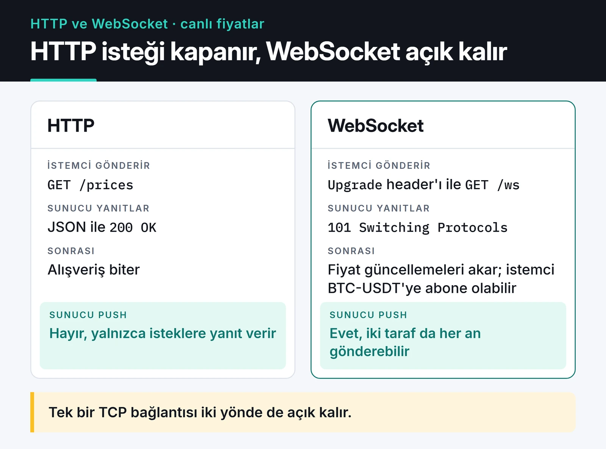
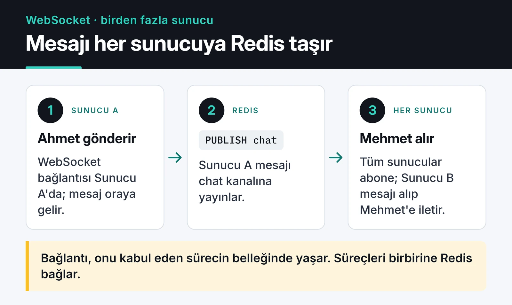

Chat, canlı skor, borsa ekranı ya da bir trading bot'unun panelini yapıyorsanız sunucunun istemciye kendiliğinden veri göndermesi gerekir. HTTP'de istemci sormadan sunucu cevap veremez. WebSocket ile gerçek zamanlı iletişim bu yüzden var: tek bir TCP bağlantısı açılır, açık kalır ve iki taraf da istediği an mesaj gönderebilir.

Bu yazıda FastAPI ile bir WebSocket sunucusu kuruyorum, sonra onu Redis Pub/Sub ile birden fazla sunucuya ölçekliyorum ve production'da karşınıza çıkacak bağlantı, kimlik doğrulama ve proxy sorunlarına bakıyorum.



## Polling, SSE ve WebSocket

WebSocket her zaman doğru cevap değil, önce alternatiflere bakmak lazım:

- Polling: istemci birkaç saniyede bir "yeni bir şey var mı?" diye sorar. Basittir ama cevapların çoğu boş döner ve gecikme, sorma aralığı kadardır.
- Server-Sent Events (SSE): sunucudan istemciye tek yönlü akış. Düz HTTP üzerinde çalışır, tarayıcı kopunca kendisi yeniden bağlanır. Bildirim, log akışı, LLM cevabı stream etmek gibi işler için genelde yeterli.
- WebSocket: çift yönlü. İstemcinin de sık sık mesaj gönderdiği chat, oyun ya da canlı işbirliği gibi senaryolarda gerekli.

Benim kuralım şu: istemci sadece dinliyorsa SSE, iki taraf da konuşuyorsa WebSocket.

## FastAPI ile tek sunucu

FastAPI'nin (Starlette üzerinden gelen) WebSocket desteği async/await ile doğal çalışıyor. Önce tek sunucuda çalışan bir oda yöneticisi:

```python
from fastapi import FastAPI, WebSocket, WebSocketDisconnect

app = FastAPI()


class Hub:
    def __init__(self) -> None:
        self.sockets: set[WebSocket] = set()

    async def connect(self, ws: WebSocket) -> None:
        await ws.accept()
        self.sockets.add(ws)

    def disconnect(self, ws: WebSocket) -> None:
        self.sockets.discard(ws)

    async def broadcast(self, text: str) -> None:
        for ws in list(self.sockets):
            try:
                await ws.send_text(text)
            except Exception:
                self.disconnect(ws)


hub = Hub()


@app.websocket("/ws/{user}")
async def chat(ws: WebSocket, user: str) -> None:
    await hub.connect(ws)
    try:
        while True:
            text = await ws.receive_text()
            await hub.broadcast(f"{user}: {text}")
    except WebSocketDisconnect:
        hub.disconnect(ws)
```

`uvicorn main:app` ile çalıştırıp iki tarayıcı sekmesinden bağlandığınızda mesajlar karşı tarafa düşer. Sorun, ikinci bir sunucu eklediğiniz anda başlıyor.

## Birden fazla sunucu: Redis Pub/Sub

WebSocket bağlantısı durumlu (stateful): bağlantı nesnesi, onu kabul eden process'in belleğinde yaşar. Load balancer arkasında iki sunucu varsa ve Ahmet A'ya, Mehmet B'ye bağlıysa, A'nın `hub.broadcast` çağrısı Mehmet'e hiç ulaşmaz.

Çözüm, sunucular arasına bir mesaj yolu koymak. Redis Pub/Sub bunun için en kolay seçenek: her sunucu gelen mesajı Redis kanalına yayınlar, tüm sunucular aynı kanala abone olup mesajı kendi bağlantılarına dağıtır.



`redis-py`'nin asyncio API'si ile:

```python
import asyncio
from contextlib import asynccontextmanager

import redis.asyncio as redis
from fastapi import FastAPI, WebSocket, WebSocketDisconnect

CHANNEL = "chat"
r = redis.from_url("redis://localhost:6379", decode_responses=True)
hub = Hub()  # yukarıdaki sınıf


async def relay() -> None:
    """Redis kanalını dinler, gelen her mesajı bu sunucudaki bağlantılara dağıtır."""
    pubsub = r.pubsub()
    await pubsub.subscribe(CHANNEL)
    async for msg in pubsub.listen():
        if msg["type"] == "message":
            await hub.broadcast(msg["data"])


@asynccontextmanager
async def lifespan(app: FastAPI):
    task = asyncio.create_task(relay())
    yield
    task.cancel()
    await r.aclose()


app = FastAPI(lifespan=lifespan)


@app.websocket("/ws/{user}")
async def chat(ws: WebSocket, user: str) -> None:
    await hub.connect(ws)
    try:
        while True:
            text = await ws.receive_text()
            await r.publish(CHANNEL, f"{user}: {text}")  # doğrudan broadcast yok
    except WebSocketDisconnect:
        hub.disconnect(ws)
```

Önemli fark: endpoint artık mesajı kendi bağlantılarına göndermiyor, Redis'e yayınlıyor. Mesaj, gönderen sunucu dahil herkese Redis üzerinden geri dönüyor.

Pub/Sub'ın bir bedeli var: "ateşle ve unut" çalışır. O an abone olmayan bir sunucu (yeniden başlıyorsa) mesajı hiç görmez ve Redis mesajı saklamaz. Chat geçmişi gerekiyorsa mesajları ayrıca veritabanına ya da Redis Streams'e yazın. Redis'in diğer kullanım alanlarını [Redis yazımda](/posts/redis-onbellekleme-oturum-yonetimi/) anlattım.

Bir de `broadcast` döngüsü bağlantıları sırayla dolaşıyor. Çok yavaş bir istemci gönderimi bekletebilir; binlerce bağlantıda her bağlantıya ayrı bir gönderim kuyruğu koymak ya da `asyncio.wait_for` ile zaman aşımı eklemek gerekir.

## Kopan ve "zombi" bağlantılar

Mobil kullanıcı tünele girer, Wi-Fi değişir. Daha kötüsü, istemci gitmiştir ama TCP kapanış paketi sunucuya hiç ulaşmamıştır. Sunucu bağlantıyı açık sanmaya devam eder.

Bunun çaresi protokol seviyesindeki ping/pong ve uvicorn bunu sizin yerinize yapıyor. Varsayılan olarak 20 saniyede bir ping gönderir ve 20 saniye içinde pong gelmezse bağlantıyı kapatır (`--ws-ping-interval` ve `--ws-ping-timeout`). Tarayıcılar ping'e otomatik cevap verir; JavaScript tarafında bir şey yazmanız gerekmez, zaten tarayıcının WebSocket API'si ping göndermeye izin vermiyor.

Uygulama seviyesinde bir "hâlâ burada mısın?" mesajına ancak kullanıcının aktif olup olmadığını bilmek istiyorsanız ihtiyaç var.

## Kimlik doğrulama

Tarayıcının `WebSocket` API'si özel header göndermeye izin vermez, yani `Authorization: Bearer ...` kullanamazsınız. Pratikte üç seçenek var:

1. Aynı domain'deyseniz cookie. Handshake normal bir HTTP isteği olduğu için cookie otomatik gider.
2. Query string'de kısa ömürlü bir bilet. Uzun ömürlü JWT'yi URL'e koymayın; URL'ler proxy ve erişim loglarına düşer. Önce normal bir HTTP endpoint'inden 30 saniyelik tek kullanımlık bir bilet alın, onu bağlanırken gönderin.
3. Bağlandıktan sonraki ilk mesajda token göndermek ve doğrulanana kadar başka mesaj kabul etmemek.

Hangisini seçerseniz seçin, `Origin` header'ını da kontrol edin. Tarayıcılar WebSocket için CORS uygulamaz, bu yüzden cookie kullanan bir uygulamada başka bir site sizin adınıza bağlantı açabilir (cross-site WebSocket hijacking).

```python
from fastapi import Query, status

ALLOWED_ORIGINS = {"https://app.example.com"}


@app.websocket("/ws")
async def secure_ws(ws: WebSocket, ticket: str = Query(...)) -> None:
    if ws.headers.get("origin") not in ALLOWED_ORIGINS:
        await ws.close(code=status.WS_1008_POLICY_VIOLATION)
        return
    user = await redeem_ticket(ticket)  # bileti doğrula ve sil
    if user is None:
        await ws.close(code=status.WS_1008_POLICY_VIOLATION)
        return
    await hub.connect(ws)
    ...
```

`redeem_ticket` sizin yazacağınız fonksiyon; bileti Redis'te `GETDEL` ile okuyup silmek basit bir yol. Bağlantıyı `accept` etmeden kapatırsanız istemci handshake'te 403 alır.

## Nginx ve load balancer ayarı

WebSocket, HTTP/1.1 `Upgrade` mekanizmasıyla başlar. Nginx bu header'ları varsayılan olarak upstream'e iletmez, ayrıca boşta kalan bağlantıyı 60 saniyede kapatır:

```nginx
location /ws {
    proxy_pass http://app_servers;
    proxy_http_version 1.1;
    proxy_set_header Upgrade $http_upgrade;
    proxy_set_header Connection "upgrade";
    proxy_set_header Host $host;
    proxy_read_timeout 1h;
}
```

Saf WebSocket kullanıyorsanız sticky session gerekmez: handshake tek bir HTTP isteğidir, sonrasında bağlantı zaten aynı sunucuda kalır. Socket.IO gibi long-polling'e geri düşebilen kütüphanelerde ise aynı istemcinin istekleri aynı sunucuya gitmeli, Nginx'te `ip_hash` ya da cookie tabanlı yönlendirme lazım. Load balancing detayları için [Nginx yazıma](/posts/nginx-yuk-dengeleme-onbellekleme/) bakabilirsiniz.

Kapasite tarafında, boşta bekleyen bir bağlantı az CPU harcar; tek bir async process on binlerce bağlantıyı tutabilir. Önce dosya tanıtıcısı limiti (`ulimit -n`) ve bellek dolar, o yüzden limitleri yükseltip yük testiyle kendi rakamınızı bulun.

## İstemci: üstel bekleme ile yeniden bağlanma

Sunucu ne kadar sağlam olursa olsun bağlantı kopacak. Sabit 3 saniyede bir yeniden denemek, sunucu deploy sırasında kapandığında tüm istemcilerin aynı anda saldırması demek. Bekleme süresini katlayarak artırın ve rastgelelik ekleyin:

```javascript
function connect(url, onMessage, attempt = 0) {
  const ws = new WebSocket(url);

  ws.onopen = () => {
    attempt = 0;
  };

  ws.onmessage = (event) => onMessage(event.data);

  ws.onclose = (event) => {
    if (event.code === 1008) return; // yetki hatası: tekrar deneme
    const base = Math.min(30000, 1000 * 2 ** attempt);
    const delay = base / 2 + Math.random() * (base / 2);
    setTimeout(() => connect(url, onMessage, attempt + 1), delay);
  };

  return ws;
}

connect("wss://app.example.com/ws?ticket=...", (data) => console.log(data));
```

Gerçek uygulamada her yeniden bağlanmada yeni bir bilet almanız gerekecek, çünkü bilet tek kullanımlık. Bir de şunu bilin: tarayıcı 1008 kodunu ancak sunucu bağlantıyı kabul edip sonra kapatırsa görür. Handshake'te 403 ile reddedilen bağlantı 1006 olarak gelir, o yüzden deneme sayısına da bir üst sınır koyun.

## Sonraki adım

Yukarıdaki Redis'li sürümü iki ayrı portta (`uvicorn main:app --port 8001` ve `--port 8002`) çalıştırıp her birine farklı sekmeden bağlanın; mesajların sunucular arasında geçtiğini görürsünüz. Ardından kötü niyetli ya da hatalı istemcilere karşı mesaj başına [rate limiting](/posts/python-hiz-sinirla-api-throttling/) eklemek iyi bir sonraki adım. Referans olarak [FastAPI WebSocket dokümantasyonu](https://fastapi.tiangolo.com/advanced/websockets/) ve [uvicorn ayarları](https://uvicorn.dev/settings/) yeterli.
